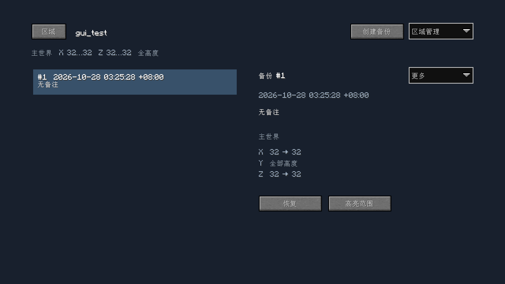
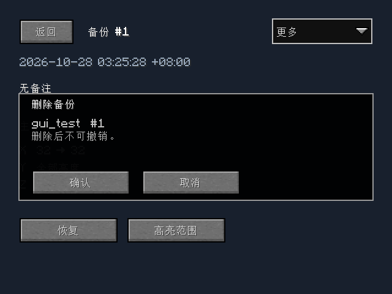
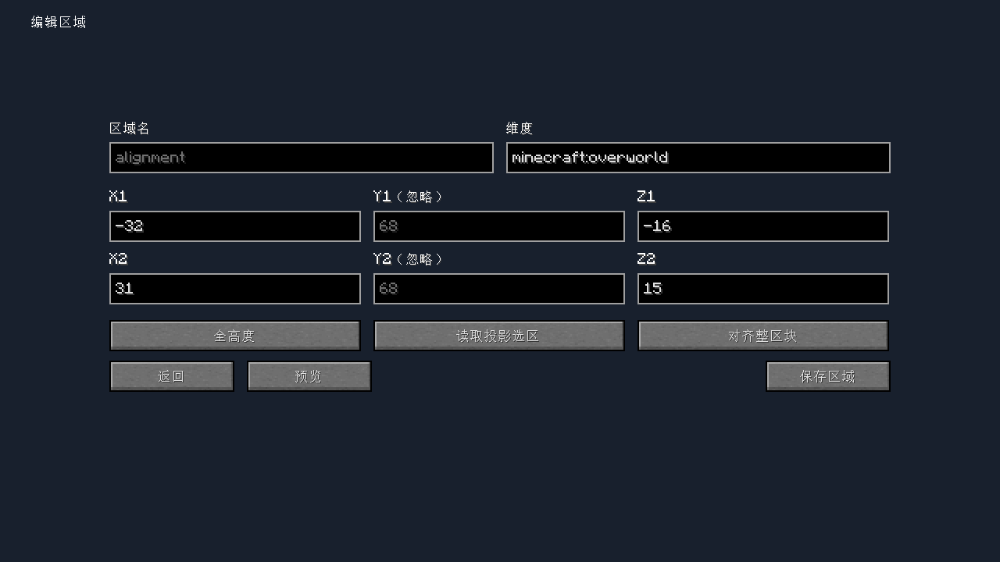
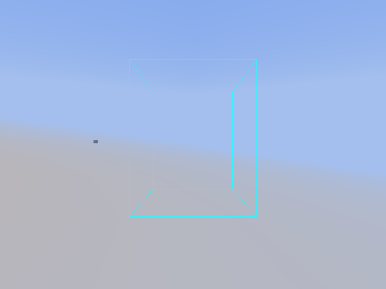

# 26.3 可选客户端管理界面回归

日期：2026-10-28。Microsoft OpenJDK 25.0.2。Minecraft、Loader、Fabric API、Loom 沿用项目原版本；malilib `4cb96026bf`，Litematica 编译接口 `101ac3a23649`。库不随 EDB 打包。

服务端协议与确认代码提交 `de2d193`；客户端及测试代码提交 `f90feec`。

## 界面与交互

- 区域列表 → 区域的备份目录。列表展示时间和备注；宽屏右侧详情，窄屏独立详情页。
- 创建备份为目录主操作；区域编辑／删除与备份备注／删除各在所属菜单。恢复与高亮跟随所选备份详情。
- 内容宽度有上限，统一边距和间距；列表无溢出时不显示满高滚动条。背景遮住聊天与 HUD，空闲时不放成功消息或说明文案。
- 恢复和删除使用 malilib 原生确认对话框。表单收到对应服务端成功结果才关闭，失败保留输入。
- 手填、投影导入、整区块对齐共用区域表单；对齐向外扩展 X/Z 并切为全高度。

实际 Fabric 客户端自动操作截图，未经绘图修改：

| 1280×720 备份目录 | 640×480 确认框 |
| --- | --- |
|  |  |

| 整区块对齐后的编辑表单 | 世界内区域线框 |
| --- | --- |
|  |  |

截图检查还发现 malilib `TextFieldWrapper` 注册输入框时会同步共享的 `TextFieldType.STRING` 长度。先设置短坐标框长度再注册，会缩短之后的维度输入框，并使重建后的光标越界、产生白色遮挡。现在先注册空框，再设置各框长度和值；测试断言重建后维度完整、无选中文字、共享 STRING 长度仍为 256。

## 自动验证

| 配置 | 结果与范围 |
| --- | --- |
| malilib + Litematica，真实加入世界的客户端 | PASS：鼠标／键盘创建区域、重复名称拒绝并保留草稿、创建备份、详情与菜单、原生确认取消、真实恢复后服务器方块由金块回到石头、删除单备份与区域 |
| 仅 malilib | PASS：相同管理流程，未安装投影时入口禁用，坐标手填可用 |
| 两个客户端库均无 | PASS：客户端正常进入／退出世界，命令仍可用，无 GUI 库链接错误 |
| 纯服务端构建 | PASS：无客户端库运行时依赖；编译与打包完成 |
| OP 2 客户端请求 | PASS：服务端拒绝并且不返回目录、备注、坐标；恢复权限后正常返回 |
| UUID 确认 | PASS：旧 GUI 令牌不能确认较新的 CLI 预览；错误令牌不能取消／消耗当前操作；GUI 和 CLI 共用确认逻辑 |
| 维护期间状态同步 | PASS：测试用闩锁暂停备份 IO，模拟暂停期间仍收到 busy 状态，释放后正常完成 |
| 目录投影 | PASS：12 区域、11 备份，8 项分页、最新优先、时间／备注／XYZ、越界页钳制、区域消失后返回根目录 |
| Litematica | PASS：实际 API 设置子选区，点击导入填入共同编辑表单，保留精确 XYZ |
| 对齐与连接清理 | PASS：负坐标范围扩至 X=-32..31、Z=-16..15、全高度；断线清除高亮 |

集成服会无条件授予世界所有者 OP 4，权限测试通过临时切换测试服的所有者身份，使实际加入客户端成为 OP 2，再还原。所有测试使用独立 `build/run` 世界，未操作用户的 Orbit 存档。

## 专用服组合压力回归

固定 [31 项依赖名单](26.3-client-management-dedicated.profile.txt)，包含 Carpet／常用 additions、Lithium、VMP、C2ME、ECO alpha.12、Async、ServerCore、Servux 等；版本见 [lock](../compatibility-lock.json)。功能断言与正常停服检查均 PASS，`max-tick-time=10000`，没有关闭 watchdog。

[原始 CSV](26.3-client-management-dedicated.csv)：

| 场景 | 备份 | 恢复 |
| --- | ---: | ---: |
| 已加载选区，五轮平均 | 672 ms | 538 ms |
| 10,000 个存盘未加载区块 | 19.868 s | 7.736 s |
| 跨 10,000 区块的精确选区 | 15.707 s | 30.005 s |

压力阶段最长维护帧 30 ms。这是本机观测；维护期间整服模拟仍暂停，不是吞吐量或最大停顿保证。该组合测试覆盖服务端功能及生命周期；GUI 网络与输入流程在上述集成服测试覆盖，没有声称 31 模组环境下所有客户端 GUI 或第三方实际网络服务均已验证。

## 重跑

```powershell
$env:JAVA_HOME='C:\Users\think book\.jdks\ms-25.0.2'
$env:TEMP='D:\Temp'; $env:TMP='D:\Temp'
.\gradlew.bat build -PedbClientLibraries=false --offline --console=plain
.\gradlew.bat runClientGameTest --offline --console=plain
.\gradlew.bat runClientGameTest -PedbClientLitematica=false --offline --console=plain
.\gradlew.bat runClientGameTest -PedbClientLibraries=false --offline --console=plain
# 依照 docs/compatibility-26.3.md 准备已接受 EULA 的专用测试目录与锁定依赖。
$profile=(Get-Content tests/results/26.3-client-management-dedicated.profile.txt -Raw).Trim()
.\gradlew.bat runEdbDedicatedTest "-PedbCompat=$profile" -PedbClientLibraries=false --offline --console=plain
```

客户端日志位于 `.gradle/research/gui-final-client*.log`，构建与专用服日志位于 `.gradle/research/gui-release-build.log` 和 `gui-release-dedicated.log`。二进制及日志校验值见[配套校验清单](26.3-client-management.sha256.txt)。
