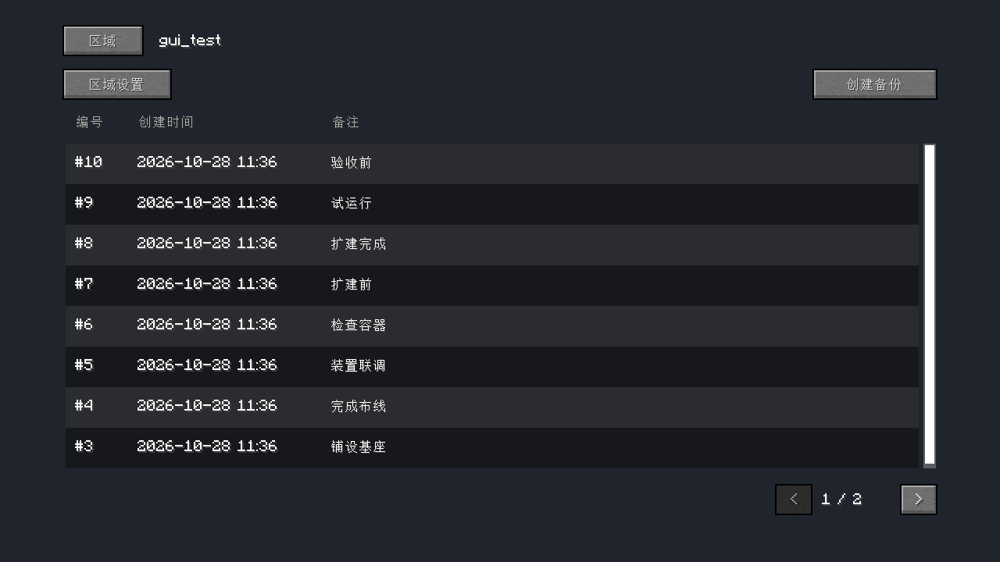
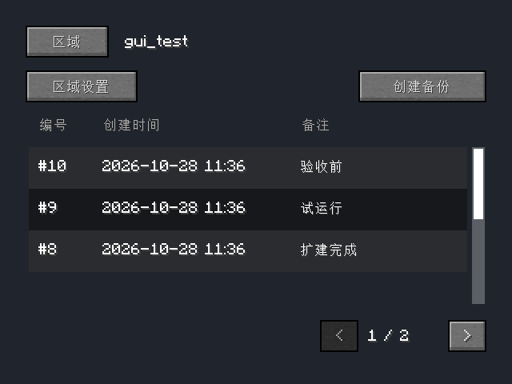
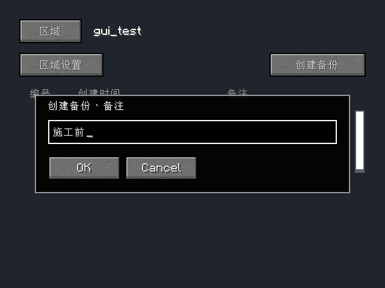
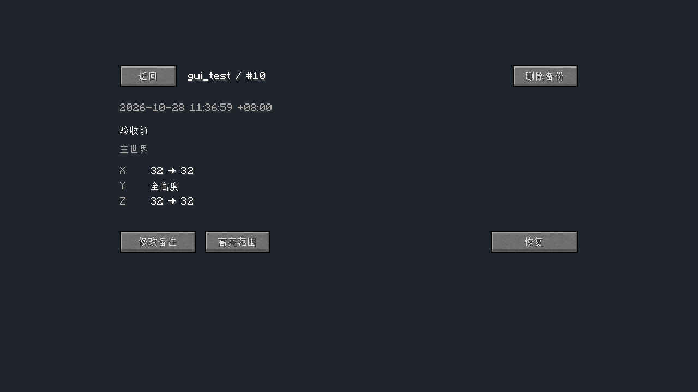
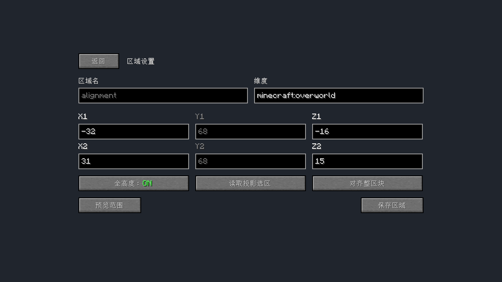

# 26.3 原生 malilib 控件与导航回归

日期：2026-10-28。此次只调整客户端界面、客户端状态提示与客户端测试；服务端协议、存档格式和备份／恢复执行路径未变。

实现与测试提交：`a605fa2`。

## 控件复用

| 功能 | 直接使用的 malilib 实现 | EDB 保留的职责 |
| --- | --- | --- |
| 目录列表 | `WidgetListStringSelection`、`WidgetStringListEntry` | 提供区域／备份键、单元格标签与打开目标 |
| 文本及截断提示 | `WidgetLabel`、`WidgetHoverInfo` | 列宽和显示内容 |
| 备注对话框 | `GuiTextInputBase` | 等待服务端结果，失败保留草稿 |
| 坐标 | `GuiTextFieldInteger` | 坐标含义和提交校验 |
| 全高度 | `ButtonOnOff` | 切换选区高度模式 |
| 危险操作确认 | `GuiConfirmAction` | 一次性令牌、目标和有效期 |

删除 `ActionMenu`，不再将下拉选择框改造成操作菜单；删除列表行的自定义绘制和遮盖滚动条的色块；删除 `CommandForm` 界面基类，异步提交状态由与控件无关的 `CommandSubmission` 共用。列表的绘制、选择框、滚动和输入由 malilib 负责。EDB 的列表适配只向库的现成行中添加原生标签，并将数据键与截断文字分开。

页面保留统一的不透明背景，避免聊天和世界画面透入；这是页面背景，不是控件实现。malilib 和 Litematica 的版本没有变更，不复制或打包库源码。

## 操作关系

大小窗口都按“区域 → 备份目录 → 备份详情”导航。备份目录展示编号、时间和备注，点击进入详情；删除备份放在详情页头，恢复放在详情内容下方。区域范围与级联删除放在“区域设置”中。取消额外的右侧详情面板及“更多”菜单。

创建备份和修改备注使用原生输入对话框，支持 Enter 提交及 Esc 取消。区域预览可以返回原草稿继续编辑。换到新目录或新表单时清除过时错误提示，真实提交失败仍保留输入。

实际游戏截图：



| 640×480 同一目录 | 原生备注对话框 |
| --- | --- |
|  |  |

| 备份详情 | 区域设置 |
| --- | --- |
|  |  |

## 验证范围

真实 Fabric 客户端测试覆盖：

- 创建区域、重名拒绝且保留输入、创建带备注备份、在原生对话框中修改备注并按 Enter 提交。
- 十个真实备份的分页、页码与第二页条目数量；640×480 和 1280×720 布局、原生列表溢出显示。
- 大小窗口使用同一详情页；取消删除、删除单个备份、删除区域及其剩余九个备份。
- 旧令牌不能确认较新 CLI 预览；通过 GUI 恢复后实际服务器方块由金块回到石头。
- 模拟暂停期间仍可收到进度；OP 2 无权读取目录。
- Litematica 导入、负坐标整区块对齐、预览返回后保留选区、断线清理高亮。
- 重新创建区域表单后维度字符串完整，且不污染 malilib 共享的字符串长度设置。

测试分别运行 malilib + Litematica、只有 malilib、两个客户端库均无三种依赖组合，均 PASS。无客户端库时验证正常进入／退出世界及命令路径；完整 Gradle 构建亦 PASS，包含两项必需服务端 GameTest 和正常停服检查。打包检查确认不包含已删除的 `ActionMenu`、`CommandForm` 或内嵌库 JAR。

此次没有重复运行 31 模组万区块压力测试：服务端代码未修改，既有结果见[前次报告](26.3-client-management.md)。本次测试使用独立 `build/run` 世界，未修改用户实例。

```powershell
$env:JAVA_HOME='C:\Users\think book\.jdks\ms-25.0.2'
$env:TEMP='D:\Temp'; $env:TMP='D:\Temp'
.\gradlew.bat runClientGameTest --offline --console=plain
.\gradlew.bat runClientGameTest -PedbClientLitematica=false --offline --console=plain
.\gradlew.bat build runClientGameTest -PedbClientLibraries=false --offline --console=plain
```

运行日志：`.gradle/research/gui-native-client.log`、`gui-native-no-litematica.log`、`gui-native-no-libraries.log`。构建及日志摘要值见[校验清单](26.3-native-client.sha256.txt)。
